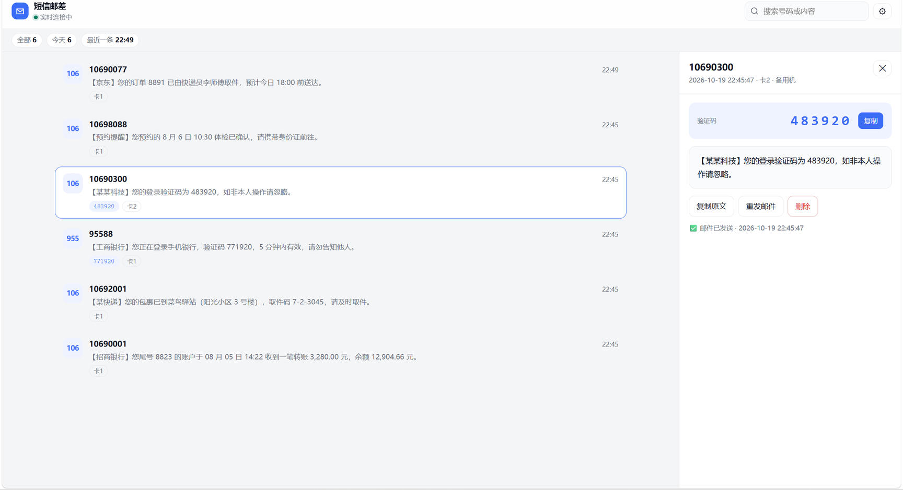

<div align="center">

# 短信邮差 · SmsMail

**备用安卓机插着卡放在家里，来短信就自动进你邮箱。**

再也不用为了收验证码天天带两个手机。

[](LICENSE)
[](package.json)
[](package.json)
[](CONTRIBUTING.md)

</div>



---

## 它能做什么

手机收到短信 → 开源 App [SmsForwarder](https://github.com/pppscn/SmsForwarder) 推给你的服务器 →
服务器发邮件到你邮箱，同时存进网页收件箱。

| 特性 | 说明 |
| --- | --- |
| 📨 **验证码直接进主题** | 自动识别「验证码 483920」，邮件标题里就能看到，不用点开 |
| 🔁 **不会丢短信** | 邮件发失败按 30s → 6h 退避重试 6 次；网页里永远留着原文，可手动重发 |
| 🖥 **网页收件箱** | 实时刷新（SSE）、按号码/内容/验证码搜索、一键复制、删除 |
| ⚙️ **在线改配置** | SMTP、收件人、过滤规则都在网页里改，改完立刻生效 |
| 🔇 **过滤降噪** | 「退订」「回复TD」这类推广短信直接丢掉；也能设白名单只转重要号码 |
| 🪶 **零依赖** | 只用 Node 内置模块，不需要 `npm install`，没有供应链风险 |
| 🔐 **双令牌 + 可选签名** | 手机端和网页端令牌分离，可再叠一层 HMAC-SHA256 防伪造 |
| 📦 **离线可用前端** | 原生 JS，不用框架、不引 CDN，内网也能跑 |

## 它是怎么工作的

```
┌──────────────────┐   HTTPS POST     ┌───────────────────────────┐   SMTP    ┌──────────┐
│  备用机 Android   │ ───────────────► │  你的服务器 / NAS / 树莓派  │ ────────► │   邮箱    │
│  SmsForwarder    │  /hook/<token>   │  sms-mailer               │ 465/587   │          │
└──────────────────┘                  └─────────────┬─────────────┘           └──────────┘
                                                    │
                                            网页收件箱（存档 / 搜索 / 重发）
```

为什么不直接让手机发邮件？因为手机直连 SMTP 发失败就彻底丢了，换手机要重配，
多个收件人要配多遍，也翻不了历史。多一层服务器之后这些都解决了，代价只是多跑一个几十 MB 的进程。

## 快速开始

### 方式 A：Docker

```bash
mkdir -p smsmail && cd smsmail
curl -O https://raw.githubusercontent.com/KeefenAn/SmsMail/main/docker-compose.yml
mkdir -p data && sudo chown -R 1000:1000 data
docker compose up -d && docker compose logs -f
```

日志里会打印登录令牌和推送地址。编辑 `data/config.json` 填上 SMTP，`docker compose restart`。

### 方式 B：一键脚本（Linux VPS）

```bash
scp -r sms-mailer root@你的服务器IP:/root/
ssh root@你的服务器IP
cd /root/sms-mailer && sudo bash deploy/install.sh
```

脚本会自动装 Node.js、建系统用户、装 systemd 服务，最后打印令牌和推送地址。
然后编辑 `/opt/smsmail/config.json` 填 SMTP，`systemctl restart smsmail`。

> 其余安装方式（手动 systemd、Nginx + Certbot、Caddy、备份迁移）见 **[部署指南](docs/deploy.md)**。

## 接上手机（3 步）

1. 安装 [SmsForwarder](https://github.com/pppscn/SmsForwarder/releases)（开源免费，安卓）
2. **发送通道** → `+` → 类型选 **Webhook**，WebServer 填 `https://你的域名/hook/<推送令牌>`，
   请求方式 `POST`，**webParams 留空**
3. **短信转发** → `+` → 匹配「所有短信」→ 通道选刚才那个

⚠️ 最后一定要做**保活**：自启动、后台运行、电池优化白名单、锁定后台。
国产 ROM 不设置的话，两三天就收不到了。

完整的逐步配置、各品牌保活清单、双卡区分、签名校验见 **[手机端配置](docs/phone-setup.md)**。

## 配置速查

最常改的几项（完整字段见 **[配置说明](docs/configuration.md)**）：

```json
{
  "smtp": {
    "host": "smtp.qq.com",
    "port": 465,
    "secure": true,
    "user": "you@qq.com",
    "pass": "邮箱授权码（不是登录密码）",
    "to": ["me@qq.com"]
  },
  "subject": "【短信】[from][code]",
  "filters": { "dropKeywords": ["退订", "回复TD"] }
}
```

| 邮箱 | 服务器 | 端口 |
| --- | --- | --- |
| QQ | `smtp.qq.com` | 465 |
| 163 | `smtp.163.com` | 465 |
| Gmail | `smtp.gmail.com` | 465 |
| Outlook | `smtp.office365.com` | 587（`secure: false`） |

## 文档

| 文档 | 内容 |
| --- | --- |
| [部署指南](docs/deploy.md) | Docker / 一键脚本 / 手动安装 / HTTPS / 备份迁移 |
| [手机端配置](docs/phone-setup.md) | SmsForwarder 全流程、保活清单、双卡、自定义报文 |
| [配置说明](docs/configuration.md) | 每个配置项的取值与含义、令牌轮换 |
| [接口文档](docs/api.md) | Webhook 字段、全部 HTTP API、对接 MacroDroid / Tasker |
| [常见问题](docs/faq.md) | 打不开、收不到邮件、后台被杀、数据在哪 |
| [架构说明](docs/architecture.md) | 数据流、模块划分、重试策略、安全模型 |
| [发布到 GitHub](docs/publishing.md) | 把这个仓库推上 GitHub 的完整清单 |

## 本地开发

```bash
node -v            # 需要 >= 20
npm test           # 79 个测试：单元 + 端到端（自带假 SMTP，不需要真邮箱）
npm run check      # 全仓库语法检查
npm run mock-smtp  # 只起一个假 SMTP，看看邮件长什么样（127.0.0.1:2525）

SMSMAIL_CONFIG=/tmp/dev.json SMSMAIL_DATA=/tmp/smsmail-data node server.js
```

项目**没有第三方依赖**，所以不需要 `npm install`。

```
sms-mailer/
├── server.js             HTTP 路由、鉴权、限流、重试队列、SSE
├── lib/
│   ├── smtp.js           零依赖 SMTP 客户端 + MIME 组装
│   ├── store.js          短信存储（JSON Lines）
│   ├── config.js         配置读写、脱敏、输入清洗
│   └── format.js         验证码提取、邮件模板
├── public/               网页收件箱（原生 JS / CSS）
├── deploy/               systemd 服务、Nginx 配置、一键安装脚本
├── test/                 node:test 测试 + 假 SMTP
├── scripts/              语法检查
└── docs/                 文档与截图
```

## 安全

- 两个令牌：`hookToken`（手机推送，出现在 URL 里）、`adminToken`（网页登录）
- 可选 HMAC-SHA256 签名（`hookSecret`）+ 时间戳，防重放
- 单 IP 每分钟 180 次限流，避免被当成开放中继
- 网页接口永不返回邮箱授权码，只返回「是否已设置」
- **务必上 HTTPS**，否则令牌在链路上是明文

发现安全问题请按 [SECURITY.md](SECURITY.md) 私下联系，不要开公开 issue。

## Roadmap

- [ ] 第二通道：Telegram / Bark / WebPush
- [ ] 短信导出 CSV / Markdown
- [ ] 可选的 SQLite 存储
- [ ] 多设备、多卡分组
- [ ] 一键部署到 Railway / Fly.io / Zeabur

有想法欢迎到 [Discussions](https://github.com/KeefenAn/SmsMail/discussions) 聊。

## 致谢

- [SmsForwarder](https://github.com/pppscn/SmsForwarder) —— 手机端转发，整个方案的基础
- 所有提 issue、提 PR 的人

## License

[MIT](LICENSE)
